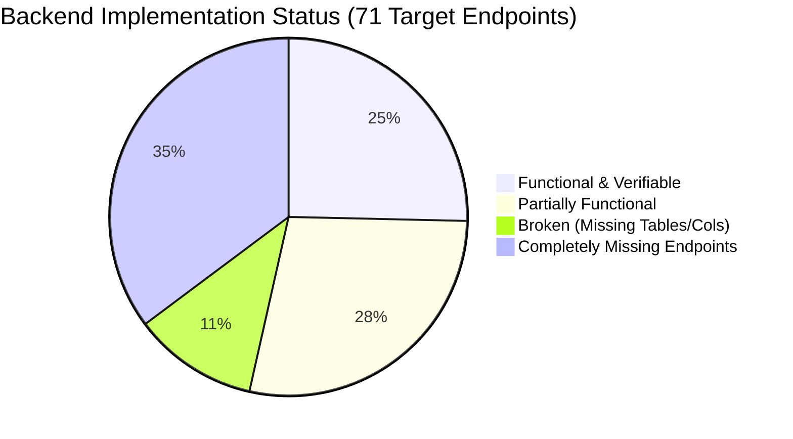

# JCB Smart CMMS — Missing Functionality & Gap Analysis
**Document ID:** `07-MISSING-FUNCTIONALITY.md`  
**Date:** November 4, 2026  
**Auditor Roles:** Senior Backend Architect, Industrial Systems Analyst  
**Scope:** Functional Gaps, Architectural Gaps, and Technical Specifications for Required Endpoints  

---

## 1. Functional Gaps Summary

While the backend outlines a 14-module structure, several core operational capabilities required for factory maintenance operations are missing from the controllers and route definitions:



---

## 2. Missing Endpoints & Technical Specifications

### 2.1 Missing Authentication Endpoints

#### 1. Token Refresh
- **Route:** `POST /api/v1/auth/refresh`
- **Purpose:** Issue a new short-lived access token using a valid 7-day refresh token.
- **Request Body:**
  ```json
  { "refreshToken": "eyJhbGciOiJIUzI1NiIsIn..." }
  ```
- **Response (`200 OK`):**
  ```json
  {
    "success": true,
    "data": { "token": "new_jwt_access_token", "expiresIn": "1d" }
  }
  ```

#### 2. User Logout & Session Revocation
- **Route:** `POST /api/v1/auth/logout`
- **Purpose:** Invalidate refresh tokens and add access tokens to a revocation list / denylist.
- **Headers:** `Authorization: Bearer <token>`
- **Response (`200 OK`):**
  ```json
  { "success": true, "message": "Session terminated successfully." }
  ```

#### 3. Self-Service Password Change
- **Route:** `PUT /api/v1/auth/change-password`
- **Purpose:** Allow authenticated users to update their credentials securely.
- **Request Body:**
  ```json
  {
    "currentPassword": "old_password",
    "newPassword": "secure_new_password"
  }
  ```
- **Validation:** Minimum 8 characters, at least 1 number and 1 special character; verify bcrypt hash of `currentPassword` before writing new hash.

---

### 2.2 Missing Work Order Lifecycle Endpoints

#### 4. Retrieve Single Work Order Detail
- **Route:** `GET /api/v1/work-orders/:id`
- **Purpose:** Fetch full work order record joined with machine details, assigned personnel, complaint images, and parts consumed.
- **Response (`200 OK`):**
  ```json
  {
    "success": true,
    "data": {
      "id": "uuid",
      "wo_number": "WO-2026-00001",
      "status": "in_progress",
      "machine": { "id": "uuid", "machine_code": "CNC-001", "name": "Mazak HMC" },
      "technician": { "id": "uuid", "full_name": "Sunil Yadav" },
      "manager": { "id": "uuid", "full_name": "Vikas Verma" },
      "sla_deadline": "2026-11-04T18:00:00Z",
      "timestamps": { "reported": "...", "started": "..." },
      "events": [ { "event_type": "ARRIVED", "timestamp": "..." } ],
      "parts_consumed": [ { "part_number": "332/Y2415", "quantity": 1 } ]
    }
  }
  ```

#### 5. Retrieve Chronological Work Order Events
- **Route:** `GET /api/v1/work-orders/:id/events`
- **Purpose:** Fetch the immutable milestone audit trail for a work order from `work_order_events`.
- **Response (`200 OK`):** Array of milestone events ordered by `timestamp ASC`.

#### 6. Operator Digital Handover Sign-Off
- **Route:** `POST /api/v1/work-orders/:id/handover`
- **Purpose:** Allow line operators to formally accept the restored machine after test cycling.
- **Allowed Roles:** `operator`, `manager`, `admin`
- **Request Body:**
  ```json
  {
    "operator_feedback_remarks": "Machine tested for 15 cycles. Boom pressure stable at 50 Bar. Accepted.",
    "satisfaction_rating": 5
  }
  ```
- **Database Persistence:** Sets `operator_acknowledged_at = NOW()`, `operator_acknowledged_by = req.user.id`, and `operator_feedback_remarks`.

---

### 2.3 Missing Complaint / Breakdown Endpoints

#### 7. Retrieve Single Complaint Detail
- **Route:** `GET /api/v1/breakdowns/:id`
- **Purpose:** Fetch complaint metadata, breakdown readings (hour meter, temperature, pressure), and attached photo URLs.

#### 8. Manager Complaint Review & Rejection
- **Route:** `PUT /api/v1/breakdowns/:id/reject`
- **Purpose:** Allow maintenance managers to reject non-breakdown issues with mandatory reasoning.
- **Allowed Roles:** `manager`, `admin`
- **Request Body:**
  ```json
  { "rejection_reason": "Operator error - tool offset incorrectly set. Reset performed. No mechanical fault." }
  ```
- **Database Persistence:** Sets status to `'rejected'` and resets machine status back to `'running'`.

---

### 2.4 Missing Inventory Endpoints

#### 9. Retrieve Single Spare Part SKU
- **Route:** `GET /api/v1/inventory/:id`
- **Purpose:** Fetch complete SKU details including warehouse zone, bin location, stock levels (physical, reserved, quarantined, available), unit cost, and supplier.

#### 10. Query Inventory Transaction Ledger
- **Route:** `GET /api/v1/inventory/transactions`
- **Purpose:** Audit stock movements with filters for `part_id`, `transaction_type`, date ranges, and performing user.
- **Allowed Roles:** `manager`, `admin`

---

## 3. Missing Enterprise Non-Functional Features

1. **Request Validation Layer (Zod):**
   - Zero routes validate incoming request schemas using Zod.
   - Required: A standard `validateRequest({ body, params, query })` middleware applied to all endpoints.
2. **Plant/Shop Multi-Tenancy Scoping Middleware:**
   - Required: An interceptor that automatically enforces `WHERE plant_id = req.user.plant_id` on all read and write queries for non-admin users.
3. **Automated PM Background Scheduler:**
   - Currently, PM work orders are generated only when `POST /pm/generate-due` is manually invoked.
   - Required: A scheduled worker (Node-cron or agenda) running daily at 00:00 to trigger preventive maintenance schedules.
4. **Structured Logging & APM:**
   - Currently uses unformatted `console.log`.
   - Required: Winston or Pino logger outputting structured JSON with correlation IDs (`reqId`).
5. **Database Health Ping:**
   - `GET /health` reports static process uptime without checking database connectivity.
   - Required: Execute `SELECT 1` to verify live database pool availability before responding `HEALTHY`.
