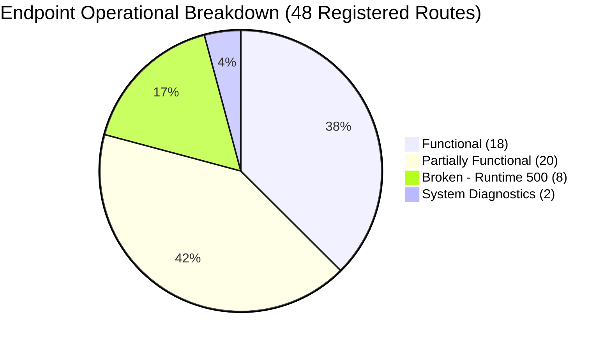

# JCB Smart CMMS — Final Backend Technical Audit Summary
**Document ID:** `FINAL-BACKEND-AUDIT-SUMMARY.md`  
**Date:** November 4, 2026  
**Auditor Roles:** Senior Backend Architect, Database Architect, Application Security Engineer, QA Engineer  
**Scope:** Final Synthesis of the Complete Read-Only Technical Audit  
**Artifact Directory:** `backend-audit/` (Reports 01 through 08)  

---

## 1. Overall System Status & Executive Verdict

The **JCB Smart Machine Maintenance Management System (CMMS)** backend currently stands at approximately **48% production readiness** (with ~65% of route drafting completed).

The application possesses a solid domain foundation: the PostgreSQL schema incorporates industrial maintenance concepts such as dual downtime tracking via stored triggers, strict stock segregation (physical, reserved, quarantined, and generated available stock), trigram indexing for high-speed spare part retrieval, and a 14-module route structure.

However, the backend is not yet ready for production or automated regression testing due to:
1. **Critical Security Flaws:** Committed cleartext database credentials, an active universal authentication backdoor, hardcoded fallback secrets, and missing role-based guards on sensitive state mutations.
2. **Schema Incompatibilities:** 6 database tables referenced in the codebase do not exist, and 1 column mismatch in inventory reservation causes silent failures.
3. **Data Integrity Hazards:** Concurrency race conditions in sequential ID generation, absence of database transactions on multi-step mutations, and zero plant-level multi-tenancy data isolation.
4. **Complete Absence of Testing:** 0.00% automated test coverage with no test framework installed.

---

## 2. Implementation Status Breakdown

### 2.1 What Is Already Implemented (Functional)
- Core Express server and Socket.IO real-time event pipeline (`backend/src/server.ts`).
- Root health diagnostics (`GET /health`, `GET /api/v1`).
- User profile retrieval and administrative user CRUD (`GET`, `POST`, `PUT`, `DELETE /api/v1/auth/users`).
- Organizational reads: active plant listing (`GET /api/v1/org/plants`) and shop listing by plant (`GET /api/v1/org/plants/:plantId/shops`).
- Machine asset listing, filtering, detail retrieval, QR code asset lookup, and administrative CRUD (`/api/v1/machines/*`).
- Breakdown complaint retrieval with filtering and pagination (`GET /api/v1/breakdowns`).
- Work order listing with technician, status, and priority filtering (`GET /api/v1/work-orders`).
- High-speed spare parts search utilizing GIN trigram indexes across 160k SKU structures (`GET /api/v1/inventory/search`).
- Administrator spare parts catalog CRUD (`POST`, `PUT`, `DELETE /api/v1/inventory/*`).
- Purchase requisition listing (`GET /api/v1/procurement/pr`).
- Active preventive maintenance schedule listing (`GET /api/v1/pm/plans`).

### 2.2 What Is Partially Implemented
- **Login (`POST /auth/login`):** Functions, but compromised by a universal backdoor check (`password === 'password123'`) and an unverified in-memory fallback dictionary.
- **Breakdown Reporting (`POST /breakdowns`):** Duplicate check and machine status updates work, but reference number sequence generation has a concurrency race condition and lacks transaction wrapping.
- **Work Order Allocation (`POST /work-orders/assign`):** Functional, but lacks `requireRoles` (operators can assign work orders) and has concurrency race conditions on `WO-` sequence generation.
- **Work Order Milestones (`POST /work-orders/:id/milestone`):** Functional, but lacks role checks and throws unhandled foreign key crashes when given invalid work order IDs.
- **Work Order Verification (`POST /work-orders/:id/verify`):** Triggers work correctly, but missing role checks allow technicians to verify their own work.
- **Stock Adjustment (`POST /inventory/adjust`):** Updates stock and logs to transactions, but lacks a transaction block and allows unvalidated negative numbers.
- **Procurement Mutations (`PUT /pr/:id`, `POST /pr/:id/grn`):** Work correctly in happy path, but lack role authorization and transaction safety.
- **RDC Challan Module (`/api/v1/rdc/*`):** Challan creation, approval, and returns function, but suffer from an N+1 query loop on listing, missing role checks, and lack of inventory synchronization.
- **Preventive Maintenance Engine (`POST /pm/generate-due`):** Generates work orders, but advances next due date prematurely upon generation rather than completion.
- **Downtime Analytics (`GET /downtime`):** Aggregates MTTR and Pareto data, but completely ignores `machine_id` and `shop_id` query filters.
- **KPI Reporting (`GET /reports/dashboard-kpis`):** Functional against live data, but swallows database errors and returns hardcoded mock stats.

### 2.3 What Is Broken (Runtime 500 Failures)
1. `GET /api/v1/org/hierarchy`: Fails with PostgreSQL error: relation `bays` does not exist.
2. `POST /api/v1/inventory/reserve`: Fails with PostgreSQL error: column `is_installed` does not exist on `wo_parts_consumed`. (Controller catches this and silently returns fake demo data).
3. `GET /api/v1/inspections/template`: Fails with PostgreSQL error: relation `inspection_templates` does not exist.
4. `POST /api/v1/inspections/submit`: Fails with PostgreSQL error: relation `inspection_records` does not exist.
5. `GET /api/v1/inspections/records`: Fails with PostgreSQL error: relation `inspection_records` does not exist.
6. `GET /api/v1/notifications`: Fails with PostgreSQL error: relation `notifications` does not exist.
7. `PUT /api/v1/notifications/:id/read`: Fails with PostgreSQL error: relation `notifications` does not exist.
8. `GET /api/v1/audit`: Fails with PostgreSQL error: relation `audit_logs` does not exist.

### 2.4 What Is Completely Missing
- **Endpoints:**
  - Token refresh (`POST /auth/refresh`) and user logout (`POST /auth/logout`).
  - User self-service password update (`PUT /auth/change-password`).
  - Single-record detail routes: `GET /work-orders/:id`, `GET /breakdowns/:id`, `GET /inventory/:id`.
  - Chronological work order milestone events endpoint: `GET /work-orders/:id/events`.
  - Operator digital handover sign-off: `POST /work-orders/:id/handover`.
  - Manager complaint review & rejection: `PUT /breakdowns/:id/reject`.
  - Inventory stock movements ledger query: `GET /inventory/transactions`.
  - Organization CRUD: `POST/PUT/DELETE /org/plants`, `/org/shops`.
- **Infrastructure:**
  - Request validation schemas (Zod is installed but not used).
  - Multi-tenant plant and shop query isolation.
  - Automated testing framework and test files (0% coverage).
  - Background cron scheduler for automated PM work order generation.

---

## 3. Security Vulnerabilities Summary

| ID | Severity | Vulnerability | File & Line | Core Impact |
|---|---|---|---|---|
| **SEC-01** | `CRITICAL` | Hardcoded Database Credentials | `db.ts:24-25`, `migrate.js:5`, `seed_rich_db.js:4` | Unrestricted administrative database takeover. |
| **SEC-02** | `CRITICAL` | Universal Authentication Backdoor | `auth.controller.ts:75, 86-92` | Universal login using `'password123'` on any account. |
| **SEC-03** | `CRITICAL` | Missing Authorization on WO Verification | `work-orders.routes.ts:17` | Technicians can self-approve their own repairs. |
| **SEC-04** | `HIGH` | Missing RBAC on State Mutations | `work-orders.routes.ts`, `procurement.routes.ts`, `rdc.routes.ts`, `pm.routes.ts` | Unauthorized stock alterations and gate pass dispatch. |
| **SEC-05** | `HIGH` | Zero Multi-Tenant Scoping (IDOR) | All controllers across all 14 modules | Personnel can view/alter records from other plants. |
| **SEC-06** | `HIGH` | Hardcoded Fallback JWT Secrets | `auth.middleware.ts:33`, `auth.controller.ts:6-7` | Token forgery if environment variables are omitted. |
| **SEC-07** | `MEDIUM` | Race Condition in Sequence Generation | `breakdowns`, `work-orders`, `procurement`, `rdc`, `pm` | Concurrency collisions on document numbers. |
| **SEC-08** | `MEDIUM` | Wildcard CORS with Credentials | `app.ts:24-27`, `server.ts:12-16` | Cross-site request abuse from untrusted origins. |
| **SEC-09** | `MEDIUM` | Missing Transactions on Multi-Step Writes | `procurement.controller.ts:124`, `inventory.controller.ts:148` | Corrupted physical and digital stock counts. |

---

## 4. Required Database Changes

1. **Migration 002 (`database/migrations/002_missing_relations.sql`):**
   - Create table `bays` (linked to `shops`).
   - Create table `production_lines` (linked to `shops`).
   - Create table `inspection_templates` (linked to machine category).
   - Create table `inspection_records` (linked to `machines` and `users`).
   - Create table `notifications` (linked to `users`).
   - Create table `audit_logs` (linked to `users`).
   - Add missing foreign key indexes across all 14 existing tables to prevent full table scans.
2. **Schema Correction in `inventory.controller.ts`:**
   - Update `POST /inventory/reserve` to query `quantity_installed` instead of non-existent `is_installed`.
   - Remove the `catch` block that masks failures as `(Demo Mode)`.
3. **Migration 003 (`database/migrations/003_sequences.sql`):**
   - Implement PostgreSQL sequences for `CMP-`, `WO-`, `PR-`, `RDC-`, and `PM-` formatted numbers.

---

## 5. What Must Be Fixed Before API Testing

Before any automated or Postman API testing begins, the following **5 blockers must be resolved**:
1. **Remove the Authentication Backdoor:** Delete line 75 and lines 86–92 in `auth.controller.ts`.
2. **Execute Migration 002:** Create the 6 missing tables to avoid immediate 500 crashes on `/inspections`, `/notifications`, `/audit`, and `/org/hierarchy`.
3. **Fix `wo_parts_consumed` Column Reference:** Align `inventory.controller.ts:173` with the actual database schema.
4. **Isolate the Test Database:** Configure a separate test database or transactional test harness so live Supabase demonstration data is not corrupted during testing.
5. **Attach Missing `requireRoles` Guards:** Protect work order assignment and verification routes.

---

## 6. What Can Be Tested Immediately

The following **18 endpoints** are operational against the live database and can be tested right away:
- `GET /health` and `GET /api/v1`
- `POST /api/v1/auth/login` (with valid user credentials)
- `GET /api/v1/auth/profile`
- `GET /api/v1/auth/users`
- `POST /api/v1/auth/users`, `PUT /api/v1/auth/users/:id`, `DELETE /api/v1/auth/users/:id` (Admin)
- `GET /api/v1/org/plants` and `GET /api/v1/org/plants/:plantId/shops`
- `GET /api/v1/machines`, `GET /api/v1/machines/qr/:uid`, `GET /api/v1/machines/:id`
- `GET /api/v1/breakdowns`
- `GET /api/v1/work-orders`
- `GET /api/v1/inventory/search`
- `POST /api/v1/inventory`, `PUT /api/v1/inventory/:id` (Admin)
- `GET /api/v1/pm/plans`

---

## 7. Recommended Implementation Order

1. **Sprint 1 (Security & Schema Alignment):**
   - Purge cleartext credentials and rotate Supabase password.
   - Remove backdoor in `auth.controller.ts`.
   - Execute Migration 002 (6 missing tables + FK indexes).
   - Fix column reference in `inventory.controller.ts:173`.
   - Attach missing `requireRoles` guards on work orders, procurement, RDC, and PM.
2. **Sprint 2 (Transactions, Sequences & Tenancy):**
   - Replace row-count sequence generation with native PostgreSQL sequences.
   - Wrap multi-table operations (work orders, GRN, RDC) in `BEGIN ... COMMIT` blocks.
   - Implement plant/shop multi-tenancy query scoping.
   - Fix ignored query parameters in downtime analytics.
3. **Sprint 3 (Missing Endpoints & Validation):**
   - Implement Zod schema validation across all endpoints.
   - Implement missing detail endpoints (`GET /work-orders/:id`, `GET /breakdowns/:id`, `GET /inventory/:id`).
   - Implement token refresh, logout, and operator digital handover.
   - Remove all mock error-swallowing fallbacks.
4. **Sprint 4 (Automated Testing & CI/CD):**
   - Install Vitest and Supertest.
   - Configure disposable test database fixtures.
   - Implement complete E2E regression test suites covering the proposed testing matrix.

---
*End of Final Backend Technical Audit Summary.*  
*Full reports 01 through 08 are available in the `backend-audit/` directory.*
